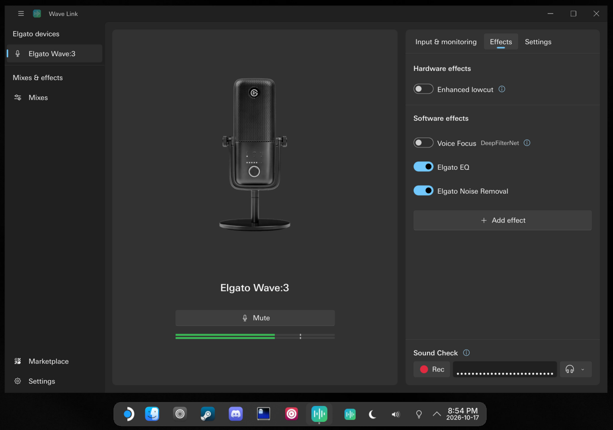

<div align="center">
  <a href="https://github.com/brandonkthomas/elgato-wave-link-linux-recomp">
    
  </a>

  <h3 align="center">Wave Link for Linux</h3>

  <p align="center">
    Elgato Wave Link recreated for Linux w/ the mixer, Wave:3 controls, Voice Focus, Elgato EQ & Noise Removal.
    <br />
    <br />
    <a href="https://isocpp.org"></a>
    <a href="https://www.qt.io"></a>
    <a href="https://pipewire.org"></a>
    <a href="https://store.steampowered.com/steamos"></a>
    <a href="https://kde.org/plasma-desktop/"></a>
  </p>
</div>

## About the Project

Elgato's Wave Link runs only on Windows and macOS. This project recreates Wave Link 3.4 for Linux for the
Elgato Wave:3, matching it as closely as possible in look and behavior. No Wave Link source exists, so
everything was rebuilt from the decompiled Windows and macOS releases and checked against them.

It runs on SteamOS 3 in desktop mode (KDE Plasma on Wayland), and should run on any x86-64 distribution
with glibc 2.36 or newer and PipeWire.

### Feature Highlights

- **Mixer**: up to 8 software and 4 hardware channels across 5 mixes (Personal, Stream, Chat and your own), with Wave Link's volume law, mutes, level meters and per-app routing.
- **Virtual devices**: the channels appear as PipeWire outputs apps play into, and each mix as an input apps like OBS or Discord can record.
- **Wave:3 controls**: gain, Gain Lock, Clipguard, Enhanced lowcut, headphone volume, Mic/PC mix and LED direction, sent over USB exactly as Wave Link sends them.
- **Effects**: Voice Focus (DeepFilterNet in place of ai-coustics), Elgato Noise Removal (RNNoise with the plugin's own settings) and a native Elgato EQ with its eight-band graph editor.
- **Sound Check**: record up to 10 seconds of your mic after its effects and play it back.
- **App and tray**: Wave Link's Windows interface rebuilt in Qt Quick, with the tray icon, settings and the per-channel dialog.

## Getting Started

Install steps are in [wavelink-linux/README.md](wavelink-linux/README.md). You need your own copy of the
Wave Link installer: the app reads Elgato's fonts, images and strings from it, and they are not part of
this repository.

### Repository Layout

| Path | Contents |
|---|---|
| `wavelink-linux/` | engine (`wavelinkd`), app (`wavelink`), packaging and install script |
| `wave3-linux/` | Wave:3 USB control library and `wave3ctl`; [docs/PROTOCOL.md](wave3-linux/docs/PROTOCOL.md) has the protocol and the reverse-engineering evidence |
| `spec/` | behavior and architecture notes taken from the decompiled Wave Link |
| `tools/` | analysis helpers: headless Ghidra scripts, libusb probes, an AU host for the Elgato plugins, the XBF→XAML converter |

Not in this repository, and never to be committed: Elgato's installers, plugins, fonts, images and
strings, and the decompiled Wave Link code (`wavelink-linux/tools/import-elgato-assets.sh` copies the
assets from your installer).

### Build and Test (from the repository root)

```sh
# Development image (Debian 13, Qt 6.8, PipeWire 1.4), then engine, unit and integration tests
docker build -t wavelink-dev:trixie -f wavelink-linux/docker/dev.Dockerfile wavelink-linux/docker
docker run --rm -v "$PWD:/w" -w /w/wavelink-linux wavelink-dev:trixie \
  bash -c 'cmake -S . -B build-linux -G Ninja && cmake --build build-linux && ctest --test-dir build-linux'
docker run --rm -v "$PWD:/w" -w /w/wavelink-linux -e WAVELINK_PLUGIN_DIR=/w/wavelink-linux/build-plugins/aarch64 \
  wavelink-dev:trixie bash engine/tests/integration.sh build-linux

# App on macOS for UI work (Homebrew Qt), against an engine in the dev image: engine/tests/demo.sh
cmake -S wavelink-linux -B wavelink-linux/build-mac -G Ninja -DCMAKE_PREFIX_PATH="$(brew --prefix qt)"
cmake --build wavelink-linux/build-mac

# x86-64 release bundle: wavelink-linux/dist/wavelink-linux-x86_64.tar.gz
docker buildx build --platform linux/amd64 -f wavelink-linux/packaging/release.Dockerfile \
  --target export --output type=local,dest=wavelink-linux/dist .
```

The integration test's effect checks need the DeepFilterNet and RNNoise LADSPA plugins for the
container's architecture in `wavelink-linux/build-plugins/<arch>/` (the release build downloads the
x86-64 ones itself).
